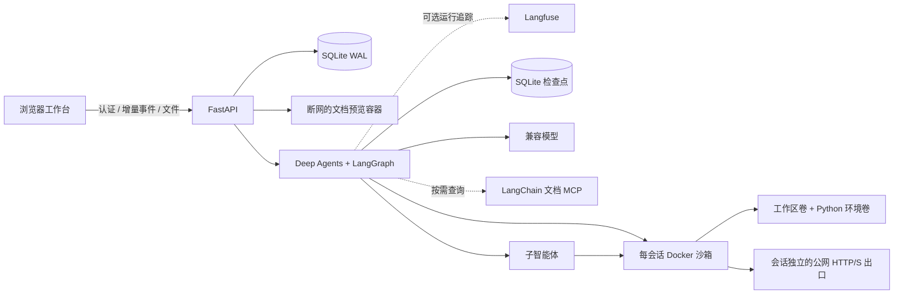

# FAMSUN Agent

丰尚的通用智能体工作台。你可以直接提问，也可以交给它一项需要查文件、运行程序或协作完成的任务。在同一个会话里读到智能体的实时回复、展开工具调用、查看子智能体的工作，并预览或下载交付文件。


[移动端工作台](docs/screenshots/glass-mobile.webp) · [登录页](docs/screenshots/login.webp) · [运行中的工具参数和结果](docs/screenshots/live-trace-running.webp) · [展开子智能体](docs/screenshots/live-trace.webp) · [收起后的最终答复](docs/screenshots/trace-collapsed.webp) · [幻灯片预览](docs/screenshots/workspace-slides.webp) · [执行视图与参考实现](docs/EXECUTION.md)

## 部署

适用于一台 Linux 主机、一个 API 进程和一个专用 Docker Engine 28+。安装 Docker Compose v2，启用 cgroup v2 的 CPU、内存和进程控制器。模型服务需支持多轮工具调用。推理服务可以部署在其他机器。

1. 将模型配置注入运行 Compose 的 shell，或复制 `.env.example` 到仅管理员可读的 `.env`。填写 `LLM_BASE_URL`、`LLM_MODEL` 和 `LLM_API_KEY`。地址可以是 API 根路径，也可以包含末尾的 `/chat/completions` 或 `/responses`。配置 `DOCKER_GID` 为 Docker socket 在控制面容器内的组 ID，通常可通过 `stat -Lc %g /var/run/docker.sock` 获得。
2. 设置 `FAMSUN_PUBLIC_ORIGIN` 为用户浏览器访问的 HTTPS 源，包括非默认端口。将 TLS 反向代理指向 `127.0.0.1:8000`。本仓库的 Compose 默认仅监听回环，启用 Secure Cookie，并关闭公开注册。
3. 在仓库根目录构建服务端、会话沙箱、文件与网络辅助镜像，以及 Office 预览镜像。启动服务后创建首个账号。

```sh
docker compose --profile build build sandbox-image helper-image preview-image app
docker compose up -d --wait app
docker compose exec app python -m famsun.manage create-user engineer
docker compose exec app python -m famsun.doctor --strict --live-model
```

`doctor` 检查 SQLite、Docker、沙箱与预览镜像。开启文档集成时也检查 MCP。加上 `--live-model` 会产生一次实际的含工具回传的模型调用。监控可轮询 `GET /api/health`。专用 Docker socket 仅挂在服务端容器，生产部署细节见[运行手册](docs/OPERATIONS.md)。

**本机 HTTP 体验**可将 `FAMSUN_PUBLIC_ORIGIN` 配为 `http://127.0.0.1:8000`，并设置 `FAMSUN_SECURE_COOKIES=false`。如需通过页面创建账户，再设置 `FAMSUN_ALLOW_SIGNUP=true`。容器配置变化后用 `docker compose up -d app` 更新。

### 可选的本地 Langfuse

管理员需要按会话查看模型用量、子智能体耗时和工具错误时，可以在同一 Docker 主机启动仓库提供的 Langfuse 4.83.0。先按上节填写根目录的 `.env`，再从仓库根目录执行下列命令。若模型地址与凭据已经注入 shell，可从最后一条命令中去掉 `--env-file .env`。

```sh
python3 deploy/langfuse/init.py
docker compose --env-file deploy/langfuse/.env -f deploy/langfuse/compose.yaml up -d --wait
docker compose --env-file .env --env-file deploy/langfuse/.env \
  -f compose.yaml -f deploy/langfuse/famsun.compose.yaml up -d --wait app
```

在 `http://localhost:3000` 登录，使用 `deploy/langfuse/.env` 中的 `LANGFUSE_INIT_USER_EMAIL` 和 `LANGFUSE_INIT_USER_PASSWORD`。在工作台完成一次新任务后，进入 **FAMSUN Agent → Tracing** 查看这次运行。初始化脚本只在首次运行时生成凭据，文件权限为 `0600`。默认导出层级、状态和可用的模型用量，管理员可单独开启脱敏内容预览。[运行追踪与 API 验证](docs/EXECUTION.md#核对-langfuse-记录) · [项目配置与隐私选项](docs/LANGFUSE.md)

## 使用

- 登录后新建会话，直接输入需求。需要交付文件时，可以指定文件名、格式及验收方式。
- 点击“执行过程”收起或展开运行详情。收起时仍能看到当前活动、状态和已经保存的最终答复。同一标签页会记住手动选择。展开后，公开回复、工具调用与子智能体按执行顺序呈现。点开工具可查看参数、结果及退出码。[执行视图](docs/EXECUTION.md)
- 打开“工作区文件”可翻阅 Word、PowerPoint 和 PDF，切换 Excel 的工作表或打印版式，查看 HTML 静态页面或源码。也支持 Markdown、CSV、图片、文本和自包含 GLB 模型。桌面预览可放大，下载按钮提供原文件。[文件预览格式与范围](docs/EXECUTION.md#查看工作区文件)
- 每个会话有独立的 Docker 工作区和 Python 安装环境，后续回合可以复用。在侧栏点击会话旁的删除按钮并确认，会永久删除该会话的记录、检查点、文件及安装环境。正在执行的任务需要先停止或等待结束。[删除确认界面](docs/screenshots/session-delete.webp)
- 技能按 Deep Agents 的 `SKILL.md` 格式组织，新增部署技能后重建沙箱镜像。[内置技能](famsun/skills)
- 官方 LangChain 文档查询默认关闭。设置 `FAMSUN_MCP_ENABLED=true` 后，模型可在遇到相关 API 问题时选择查询，实际调用时才连接 `https://docs.langchain.com/mcp`。

## 架构



运行层实现见 [harness.py](famsun/harness.py)，活动树映射见 [trace.py](famsun/trace.py)。采用官方的 `create_deep_agent`、`BaseSandbox`、`AsyncSqliteSaver` 和 `MultiServerMCPClient`。锁文件固定了此次构建的依赖版本。上游接口参见 [Deep Agents 文档](https://docs.langchain.com/oss/python/deepagents/overview)、[沙箱后端](https://docs.langchain.com/oss/python/deepagents/sandboxes) 和 [MCP 适配器](https://github.com/langchain-ai/langchain-mcp-adapters)。

## 开发与验证

```sh
uv sync --locked --group eval
(cd web && npm ci && npm run build)
docker build -f deploy/helper.Dockerfile -t famsun-helper:local .
docker build -f deploy/preview.Dockerfile -t famsun-preview:local .
docker build -f deploy/sandbox.Dockerfile -t famsun-sandbox:local .
uv run --locked --group eval pytest -q
FAMSUN_ALLOW_SIGNUP=true FAMSUN_SECURE_COOKIES=false \
  uv run --locked uvicorn famsun.api:app --host 127.0.0.1 --port 8000
```

五项真实验收经由产品的 HTTP 接口完成。评估器读取每个运行的父子事件，下载产物并独立验证其数值或几何。可提供专用的 `FAMSUN_EVAL_USERNAME`、`FAMSUN_EVAL_PASSWORD`；只在允许注册的测试部署上自动创建验收账号。每次指定新的证据目录。

```sh
uv run --locked --group eval python -m evals.live \
  --base-url http://127.0.0.1:8000 --output var/evidence/release-01 --parallel 2
```

浏览器、模型和 Docker 的实测范围见[验收报告](docs/TEST_REPORT.md)。工程场景另有五项独立校验，包含三体轨道和制粒机爆炸图。[工程验收记录与产物](evals/results/README.md)
