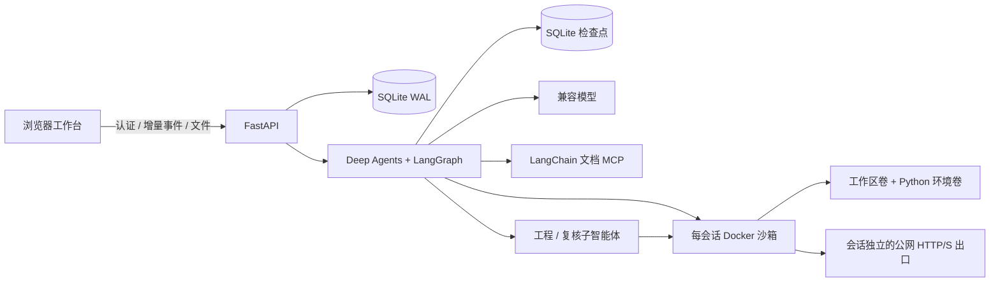

# FAMSUN Agent

面向工程任务的多用户工作台。用户可以在会话中提出任务，展开每一步的模型响应、工具和子智能体，随后在同一页面查看数据、图片和三维模型。GLB 查看器支持旋转、缩放和零件分离。服务端使用 LangChain Deep Agents、FastAPI 和 SQLite，模型通过 OpenAI 兼容的 **Chat Completions** 接口调用。


## 部署

适用于一台 Linux 主机、一个 API 进程和一个专用 Docker Engine 28+。安装 Docker Compose v2，启用 cgroup v2 的 CPU、内存和进程控制器。模型服务需支持多轮工具调用。推理服务可以部署在其他机器。

1. 将模型配置注入运行 Compose 的 shell，或复制 `.env.example` 到仅管理员可读的 `.env`。填写 `LLM_BASE_URL`、`LLM_MODEL` 和 `LLM_API_KEY`。地址可以是 API 根路径，也可以包含末尾的 `/chat/completions` 或 `/responses`。配置 `DOCKER_GID` 为 Docker socket 在控制面容器内的组 ID，通常可通过 `stat -Lc %g /var/run/docker.sock` 获得。
2. 设置 `FAMSUN_PUBLIC_ORIGIN` 为用户浏览器访问的 HTTPS 源，包括非默认端口。将 TLS 反向代理指向 `127.0.0.1:8000`。本仓库的 Compose 默认仅监听回环，启用 Secure Cookie，并关闭公开注册。
3. 在仓库根目录构建服务端、沙箱和轻量文件读取/网络代理镜像，启动服务，配置首个账号：

```sh
docker compose --profile build build sandbox-image helper-image app
docker compose up -d --wait app
docker compose exec app python -m famsun.manage create-user engineer
docker compose exec app python -m famsun.doctor --strict --live-model
```

`doctor` 检查 SQLite、Docker、沙箱镜像和官方 MCP。加上 `--live-model` 会产生一次实际的含工具回传的模型调用。监控可轮询 `GET /api/health`。专用 Docker socket 仅挂在服务端容器，生产部署细节见 [运行手册](docs/OPERATIONS.md)。

**本机 HTTP 体验**可将 `FAMSUN_PUBLIC_ORIGIN` 配为 `http://127.0.0.1:8000`，并设置 `FAMSUN_SECURE_COOKIES=false`。如需通过页面创建账户，再设置 `FAMSUN_ALLOW_SIGNUP=true`。容器配置变化后用 `docker compose up -d app` 更新。

## 使用

- 登录后新建会话，描述产物及验收方式，例如“构建环模制粒机的装配 GLB，保留独立命名零件，生成爆炸图并检查各零件几何不变”。
- 展开运行，查看模型何时调用 `execute`、`read_file` 或工程子智能体。页面刷新后可以从 SQLite 恢复会话和事件。进行中的任务可以取消。
- 从工作区面板打开生成的图片、文本数据或独立 GLB；其他格式可以下载。文件属于当前用户的当前会话。后续对话继续使用相同的工作区、已安装的包和 LangGraph 线程。
- 科学仿真技能可读取任务指定的质量、初值和积分区间，求解 N 体轨道并输出 CSV、图像和守恒误差。机械装配技能可从零件清单构造命名网格，生成装配和爆炸 GLB；模型负责确定零件、尺寸、姿态及拆卸方向。
- 工程技能以标准 `SKILL.md` 编写，位置为 [famsun/skills](famsun/skills)。新增技能后重新构建沙箱镜像。官方文档 MCP 使用 `https://docs.langchain.com/mcp`，只向模型注册文档检索工具；文档服务故障会记录在轨迹中。

## 模型与验收样例

[五项真实运行的报告和可下载产物](evals/results/README.md)包含三体轨道数据、制粒机装配与爆炸 GLB、振动频谱、配方及停机归因。另附一份参数化建模的[制粒机工程展示样例](examples/pellet_press/README.md)，带可编辑源码、检修门、穿孔环模和成对压辊。


## 架构



运行层实现见 [harness.py](famsun/harness.py)，活动树映射见 [trace.py](famsun/trace.py)。采用官方的 `create_deep_agent`、`BaseSandbox`、`AsyncSqliteSaver` 和 `MultiServerMCPClient`。锁文件固定了此次构建的依赖版本。上游接口参见 [Deep Agents 文档](https://docs.langchain.com/oss/python/deepagents/overview)、[沙箱后端](https://docs.langchain.com/oss/python/deepagents/sandboxes) 和 [MCP 适配器](https://github.com/langchain-ai/langchain-mcp-adapters)。

## 开发与验证

```sh
uv sync --locked --group eval
(cd web && npm ci && npm run build)
docker build -f deploy/helper.Dockerfile -t famsun-helper:local .
docker build -f deploy/sandbox.Dockerfile -t famsun-sandbox:local .
uv run --locked --group eval pytest -q
FAMSUN_ALLOW_SIGNUP=true FAMSUN_SECURE_COOKIES=false \
  uv run --locked uvicorn famsun.api:app --host 127.0.0.1 --port 8000
```

五项真实验收经由产品的 HTTP 接口完成。评估器读取每个运行的父子事件，下载产物并独立验证其数值或几何。可提供专用的 `FAMSUN_EVAL_USERNAME`、`FAMSUN_EVAL_PASSWORD`；只在允许注册的测试部署上自动创建验收账号。每次指定新的证据目录。

```sh
uv run --locked --group eval python -m evals.live \
  --base-url http://127.0.0.1:8000 --output var/evidence/release-01 --parallel 2
```

本次工作台、模型和 Docker 实测的范围与结果见 [验收报告](docs/TEST_REPORT.md)。
