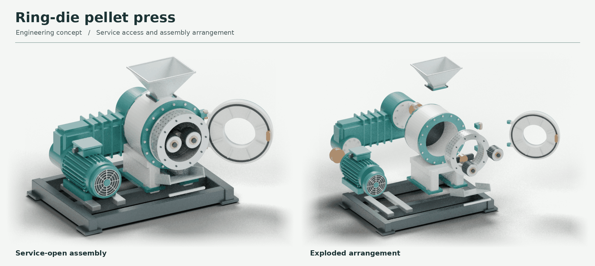

# 环模制粒机概念装配

本示例由项目作者参数化建模，展示环模、成对压辊、传动和检修门之间的空间关系。采用假设尺寸、配色与部件布置。用于工程沟通、交互预览和文件格式验证。制造、载荷、强度、传动比、安装公差和安全防护均需另行工程设计。FAMSUN 实机图纸及产品规格未用于建模。



| 文件 | 内容 |
| --- | --- |
| [assembled.glb](assembled.glb) | 完整概念装配。检修门绕竖直铰轴打开约 141°，便于观察两只压辊和环模。 |
| [exploded.glb](exploded.glb) | 相同 16 个命名网格组沿各自装配方向平移，保留颜色、朝向和尺寸。 |
| [preview.png](preview.png) | 将两份已导出的 GLB 分别重新导入 Blender，以同一相机方向独立取景并渲染。 |

GLB 使用米和 Y 轴向上的坐标约定。检修门开启时，装配包围盒约为 2.819 m 宽、1.784 m 高、1.818 m 深。环模主体外径 0.780 m、内径 0.574 m、轴向长度 0.196 m。三排共 138 个径向通孔贯穿内外圆柱面。独立网格检查确认带孔环体为闭合曲面，含 13,984 个三角面，欧拉示性数为 −276，与该环体增加 138 个贯穿孔的拓扑相符。压辊外缘采用带轻微扭转的槽纹，端部建有轴套和紧固件。电机散热片、端子盒、防护网、减速箱、轴、上料斗与下料溜槽按用途分组。

两份文件均为自包含的 glTF 2.0 二进制，含 42,056 个三角形和 10 种材质。各节点的 `extras.explosion_translation_m` 记录从装配位置到爆炸位置的 glTF 坐标位移，可用于插值动画。查看器只需加载其中任一 GLB 即可旋转检查。

## 复现

在项目根目录执行以下命令。验证环境使用 Blender 4.3.2、Cycles CPU 渲染及 Blender Python 中的 Pillow 11.1。系统 `PATH` 应包含具有 glTF 导入导出支持的 `blender`。没有 DejaVu Sans 字体时，预览图使用 Pillow 的默认字体。

```bash
uv sync --locked
uv run --no-sync -- blender -b -t 4 --python-exit-code 1 --python examples/pellet_press/build.py
uv run --no-sync -- python examples/pellet_press/verify.py
uv run --no-sync -- blender -b -t 4 --python-exit-code 1 --python examples/pellet_press/render.py
```

`build.py` 按米建立零件、设置 PBR 材质及刚性平移量。`verify.py` 对比节点名、材质、网格定义、缓冲区和完整二进制几何数据，检查各零件仅发生指定平移，并计算两套包围盒。`render.py` 从导出文件中的顶点拟合正交相机，不需要外部贴图或模型资产。
